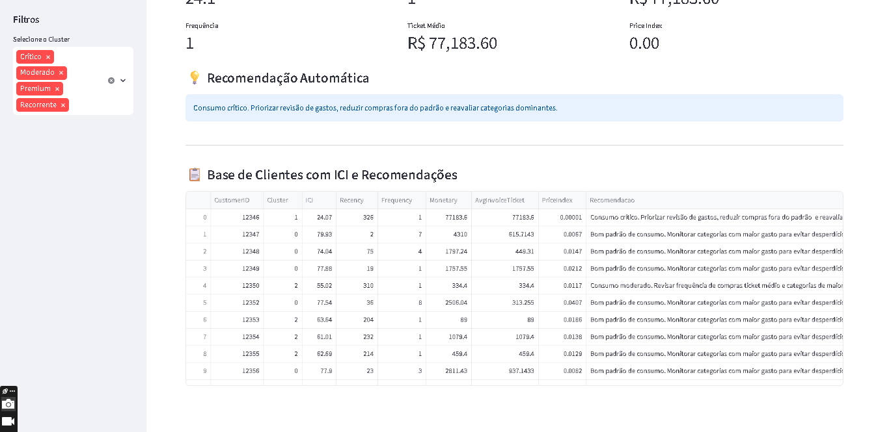

# Consumo Inteligente
### Da base de compras à análise de perfis de clientes

Projeto de hackathon que reúne preparação de dados, indicadores de consumo, segmentação de clientes e visualização interativa para apoiar a análise de um negócio.

**Python · SQL · K-Means · Power BI · Streamlit**

## O problema

Registros de compras, sozinhos, não mostram quais clientes compram com frequência, quais concentram maior valor ou quais precisam de uma análise mais cuidadosa. Este projeto transforma a base em indicadores por cliente e permite explorar diferentes perfis de consumo.

## A solução apresentada

- Limpeza e preparação dos dados em notebooks.
- Análise RFM: recência, frequência e valor monetário.
- Segmentação de clientes com K-Means.
- Índice de Consumo Inteligente (ICI) e recomendações por cliente.
- Consultas SQL para explorar e comparar grupos.
- Aplicativo Streamlit com indicadores, filtros por perfil e consulta individual.
- Visualização complementar em Power BI.

## Veja os resultados do projeto

### Visão geral do aplicativo


### Recomendações por cliente


### Dashboard em Power BI


## Por que isso interessa a uma empresa?

O fluxo demonstra como organizar dados de compras, comparar perfis e tornar indicadores acessíveis em uma interface. Pode servir como ponto de partida para estudos de relacionamento com clientes e acompanhamento de consumo, após adaptação e validação para o negócio.

Este é um projeto de portfólio: não são alegados clientes atendidos, ganhos financeiros ou economias de tempo reais.

## Organização

| Pasta | Conteúdo |
| --- | --- |
| `data/raw/` | Base original Online_Retail.xlsx |
| `data/processed/` | Bases analíticas em CSV e banco SQLite |
| `notebooks/` | Preparação, RFM, clusterização, ICI e análises SQL |
| `app/` | Aplicativo Streamlit e dependências |
| `powerbi/screenshots/` | Imagem do dashboard em Power BI |
| `sql/queries/` | Consultas de exploração dos indicadores |

## Executar o aplicativo

Com Python e Git instalados, execute:

```bash
git clone https://github.com/agtavice-cloud/consumo-inteligente-hackathon.git
cd consumo-inteligente-hackathon
python -m pip install -r app/requirements.txt
python -c "from shutil import copyfile; copyfile('data/processed/customer_features_cluster_ICI.csv', 'customer_features_cluster_ICI.csv')"
python -m streamlit run app/app.py
```

Abra o endereço local informado pelo Streamlit. A cópia do CSV é necessária porque a versão atual do aplicativo procura esse arquivo na pasta de execução.

Esses comandos utilizam os dados já preparados, sem precisar executar novamente os notebooks. As instruções foram conferidas com a estrutura e o código; a execução completa do aplicativo não foi validada nesta revisão de documentação.

## Como explorar

1. Observe os indicadores gerais da base.
2. Selecione um ou mais perfis no filtro lateral.
3. Escolha um cliente para consultar seus indicadores e sua recomendação.
4. Compare os gráficos e examine a tabela analítica.

## Notas de interpretação

- Os indicadores do topo representam a base completa; gráficos e tabela usam os perfis selecionados.
- Mantenha pelo menos um perfil selecionado: a versão atual não trata a seleção vazia na consulta individual.
- O ICI é um indicador desenvolvido no projeto; sua validade para outro contexto precisa ser avaliada.
- As recomendações são parte do protótipo e precisam de avaliação antes de uso operacional.
- A interface exibe o símbolo R$, mas isso não comprova a moeda original nem uma conversão cambial. Confira a origem e a moeda da base antes de interpretar valores financeiros.

## Contato

**Agta Pereira** · Análise de dados e automação · Atendimento remoto em todo o Brasil.

[Portfólio](https://agtapereira.com.br/) · [LinkedIn](https://www.linkedin.com/in/agta-silva) · [GitHub](https://github.com/agtavice-cloud)
